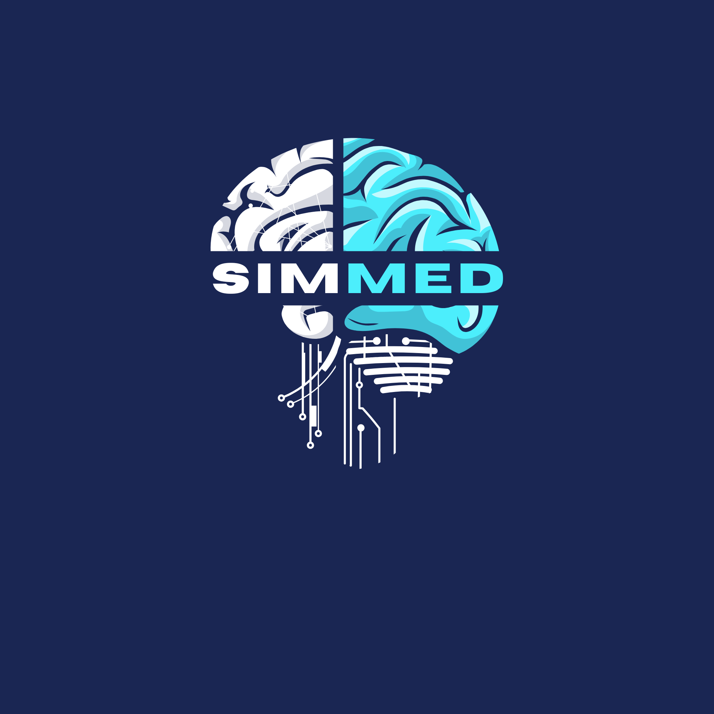
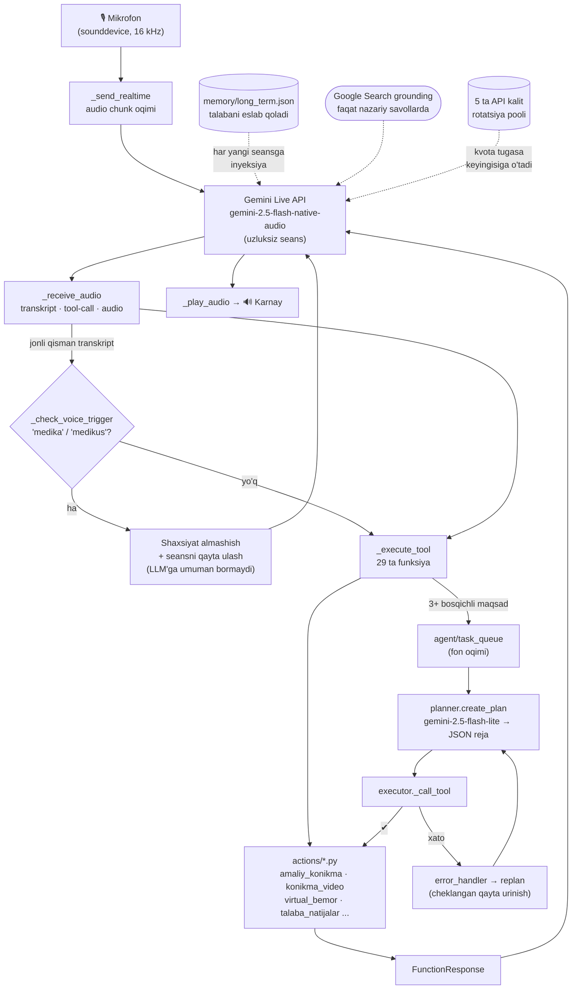

<div align="center">



# SIMMED

**O'zbek tilida real vaqtda gaplashadigan ovozli AI klinik mentor**

Andijon davlat tibbiyot instituti Simulyatsiya markazi uchun

[](https://python.org)
[-4285F4?logo=google&logoColor=white)](https://ai.google.dev)
[](https://pypi.org/project/PyQt6/)
[](#)
[](#)

</div>

---

> **Bu repozitoriya — loyiha kodining bir qismi (code sample).**
> President AI Award arizasi uchun tayyorlangan. To'liq tizimning yadro qismi
> shu yerda: ovozli agent oqimi, tool arxitekturasi, ko'p bosqichli planner va
> klinik xavfsizlik qatlami. Nima kiritilmagani va nega — [pastda](#-nima-kiritilmagan-va-nega).

---

## Muammo

Simulyatsiya markazida bitta o'qituvchiga o'nlab talaba to'g'ri keladi. Amaliy
ko'nikmani mashq qilish uchun navbat kutiladi; darsdan tashqari vaqtda esa
talabani tekshiradigan, xatosini ko'rsatadigan mentor umuman yo'q. Natijada
talaba real bemorga birinchi marta amaliyotda — xato bahosi eng qimmat bo'lgan
joyda yaqinlashadi.

Bunga qo'shimcha to'siq: mavjud tibbiy AI vositalari ingliz yoki rus tilida.
**O'zbek tilida gapiradigan klinik AI mentor mavjud emas edi.**

## Yechim

SIMMED har bir talabaga shaxsiy klinik ustoz beradi. Talaba mikrofonga savol
beradi — bir soniyada jonli ovozli javob oladi. Klaviatura ham, tugma ham
kerak emas: qo'li steril qolgan holda ham ishlaydi.

| Modul | Nima qiladi |
|---|---|
| **Amaliy ko'nikma** | 270+ ADTI ko'nikmasi bo'yicha bosqichma-bosqich protokol: ta'rif → qadamlar → muhim raqamlar (doza, chastota, norma) → xavf chegarasi |
| **Tekshirilgan video** | Ko'nikma videosini **faqat** oq ro'yxatdagi manbalardan ochadi: ADTI kanali, WHO, Geeky Medics, Osmosis. Tasodifiy YouTube natijasi hech qachon ishlatilmaydi |
| **Virtual bemor** | AI bemor rolini o'ynaydi: talaba anamnez yig'adi, differensial tashxis qo'yadi, tizim klinik fikrlashni baholaydi |
| **Test / OSCE** | Imtihon o'tkazish, natijalarni saqlash, zaif mavzularni aniqlash |
| **O'qituvchi paneli** | Har bir talabaning rivojlanishi bo'yicha bir bosishda PDF hisobot |
| **Ikki shaxsiyat** | **MEDIKUS** (erkak) / **MEDIKA** (ayol) — ovoz orqali, seans uzilmasdan almashadi |

---

## Arxitektura



### Muhandislik qarorlari (nega aynan shunday)

**1. Shaxsiyat almashish LLM'gacha ushlanadi.**
`_check_voice_trigger()` jonli *qisman* transkriptga regex qo'llaydi. "Medika" deyilsa,
bu gap Gemini'ga umuman yuborilmaydi — to'g'ridan-to'g'ri ovoz almashtiriladi va seans
qayta ulanadi. Bu kechikishni va token sarfini kamaytiradi; almashishni tool-call'ga
o'tkazish sekinroq va ishonchsizroq bo'lardi.

**2. Kalit rotatsiyasi — jonli seansni o'ldirmasdan.**
`config/api_keys.json` 5 tagacha kalit saqlaydi. Kvota xatosi kelganda `_rotate_api_key()`
keyingisiga o'tadi va seans qayta ulanadi. Dars o'rtasida "kvota tugadi" degan uzilish
o'quv jarayonini buzadi — bu tizim uchun qabul qilib bo'lmaydigan holat.

**3. Grounding — tanlab.**
Google Search grounding faqat nazariy/faktik savollarda yoqiladi; amaliy simulyatsiya
oqimida o'chiriladi (tezlik muhim). Model grounding'ni rad etsa, `_grounding_enabled`
avtomatik `False` bo'lib dastur grounding'siz qayta ulanadi — foydalanuvchi uchun uzilish
sezilmaydi.

**4. Video — oq ro'yxat, generatsiya emas.**
`actions/skill_video.py` uch bosqichda ishlaydi: qo'lda tekshirilgan `direct_url` → ADTI
o'z kanali → `channelId` bilan **cheklangan** qidiruv. Topilmasa — "topilmadi" qaytadi va
model og'zaki tushuntirishga o'tadi. Tibbiy ta'limda noto'g'ri video noto'g'ri matndan
xavfliroq: talaba uni takrorlaydi.

**5. Bitta tool konvensiyasi.**
Har bir action moduli bir xil imzoga ega: `fn(parameters: dict, response=None, player=None)`.
Yangi tool qo'shish = `TOOL_DECLARATIONS`ga sxema + `_execute_tool`ga tarmoq +
`actions/<nom>.py`. Shu sababli 29 ta tool bitta dispatcher orqali boshqariladi.

---

## Klinik xavfsizlik qatlami

Tibbiy AI'da eng katta xavf — ishonch bilan aytilgan noto'g'ri javob. Tizimga
kiritilgan cheklovlar:

- **Rol chegarasi.** SIMMED o'zini shifokor deb ko'rsatmaydi — u *klinik simulyatsiya
  assistenti*. Bu system prompt darajasida qat'iy.
- **Fallback qoidasi.** Ishonch komil bo'lmasa — ochiq aytadi va rasmiy manbaga
  yo'naltiradi. "Bilmayman" — ruxsat etilgan javob.
- **Doimiy ogohlantirish.** Jiddiy klinik qarorda malakali shifokor bilan maslahatlashish
  eslatiladi.
- **`temperature = 0.4`** — klinik aniqlik uchun past; `max_output_tokens = 2048` —
  protokol javobi o'rtada kesilib qolmasligi uchun.
- **Manba nazorati.** Tekshirilmagan video hech qachon taklif etilmaydi.
- **Imtihon halolligi.** Test/OSCE oqimida model javobni oshkor qilmaydi.

> Tarixi: [`HISOBOT_ROSOMED.md`](#) — tashqi mutaxassis sinovidan keyin system prompt
> to'liq qayta yozilgan (Sokratik-Direktiv gibrid: amaliy protokolda **to'liq** javob
> majburiy, Sokratik uslub faqat klinik fikrlashni chuqurlashtirish uchun).

---

## Repozitoriya tarkibi

```
main.py                       # Ovozli agent yadrosi — SimmedAgent, 29 tool sxemasi,
                              #   4 ta parallel asyncio oqimi, kalit rotatsiyasi,
                              #   shaxsiyat trigger'lari, klinik system prompt
core/prompt.txt               # Tool-routing va bajarish qoidalari (system promptga qo'shiladi)

actions/
  amaliy_konikma.py           # Bilim bazasidan qidirish (lotin↔kirill translit + skoring)
  skill_video.py              # Tekshirilgan manbadan video (3 bosqichli oq ro'yxat)
  virtual_bemor.py            # AI virtual bemor: keys generatsiyasi → suhbat → baholash
  talaba_natijalar.py         # Talaba natijalari va zaif mavzular tahlili

agent/
  planner.py                  # Maqsad → qat'iy JSON reja (gemini-2.5-flash-lite)
  executor.py                 # Rejani bajarish, tool chaqirish (voice loop'dan tashqarida)
  error_handler.py            # Xatoni tasniflash → replan qarori
  task_queue.py               # Fon oqimi navbati (ovozli seansni bloklamaydi)

memory/
  memory_manager.py           # Uzoq muddatli xotira, belgi byudjeti bilan cheklangan
  config_manager.py           # Birinchi ishga tushirishda API kalit sozlash

data/
  amaliy_video_manbalar.json          # 6 tekshirilgan kanal + 28 klinik soha
  amaliy_konikmalar.sample.json       # Bilim bazasi sxemasi + 3 namuna yozuv
config/
  api_keys.example.json               # Kalit fayl namunasi (haqiqiysi gitignore'da)
```

## Ishga tushirish

```bash
python -m venv .venv
.venv\Scripts\activate
pip install -r requirements.txt

# Kalitlarni sozlash
copy config\api_keys.example.json config\api_keys.json
# api_keys.json ichiga o'z Gemini kalitingizni qo'ying

python main.py
```

Talab: **Windows**, **Python 3.11**, mikrofon va karnay.
Tizim `pywin32`, `pycaw`, `win10toast` va PyQt6'ga tayanadi — kross-platforma emas,
bu ataylab qilingan tanlov: markaz sinfxonalarida Windows kompyuterlar ishlaydi va
ilova `.exe` sifatida internetsiz o'rnatiladi.

---

## ⚠️ Nima kiritilmagan va nega

Bu ochiq repozitoriya — **ko'rgazma nusxa**. Quyidagilar ataylab chiqarilmagan:

| Kiritilmagan | Sabab |
|---|---|
| `ui.py` (~9 000 qator PyQt6) va `canvas3d.py` | Hajmi; kod namunasi uchun yadro muhimroq |
| To'liq `data/amaliy_konikmalar.json` (270+ ko'nikma) | ADTI o'quv materiallari — institut mulki. Sxema va 3 namuna yozuv berilgan |
| `data/staff.json`, `data/photos/` | Markaz xodimlarining ismi, telefoni, surati — shaxsiy ma'lumot |
| `admin_students.json`, `admin_results.json`, `virtual_kasalxona.json` | Talabalarning imtihon natijalari — shaxsiy ma'lumot |
| `memory/long_term.json` | Foydalanuvchi xotirasi — shaxsiy ma'lumot |
| `config/api_keys.json` | Sirlar. Repozitoriya tarixida hech qachon bo'lmagan; `.gitignore`da |

---

## Holati

- ✅ Ishlaydigan MVP — Andijon davlat tibbiyot instituti Simulyatsiya markazida
  real talabalar bilan sinovdan o'tmoqda
- ✅ **DGU davlat guvohnomasi** bilan ro'yxatdan o'tkazilgan
- ✅ Tashqi mutaxassis (Rosomed) sinovidan o'tib, klinik javob sifati bo'yicha
  to'liq qayta ishlangan
- 🔜 O'zbekistonning boshqa tibbiyot oliygohlari va kollejlariga kengaytirish;
  hamshiralik va shoshilinch yordam xodimlarini o'qitish moduli

---

<div align="center">

**Muallif:** Abduraimov Firdavsiy Alisher o'g'li

*Maqsad: har bir tibbiyot talabasi bemorga yetib borishdan oldin
yuzlab marta xavfsiz mashq qilgan bo'lsin.*

</div>

---

<details>
<summary><b>English summary</b></summary>

**SIMMED** is a real-time, Uzbek-speaking voice AI clinical mentor built for the
Simulation Center of Andijan State Medical Institute — the first of its kind in Uzbek.

A student speaks into the microphone and gets a spoken answer in about a second.
The system teaches 270+ practical clinical skills step by step, plays procedure videos
**only** from a whitelist of verified sources (the institute's own channel, WHO,
Geeky Medics, Osmosis), role-plays as an AI virtual patient to grade a student's
history-taking and differential diagnosis, runs tests and OSCE exams, and generates a
one-click PDF progress report for the instructor.

**Stack.** A continuous voice loop over the Gemini Live API (native-audio):
four concurrent asyncio tasks stream mic audio in and synthesized speech out, with live
transcription and function calling across 29 tools. Multi-step goals are handed to a
background planner/executor with bounded replanning. Google Search grounding is enabled
selectively for factual questions; a rotation pool of up to five API keys keeps a live
session alive through quota exhaustion. Python 3.11 + PyQt6, shipped as a Windows
desktop app that runs in classrooms with limited internet.

**Safety.** SIMMED never presents itself as a physician. It states uncertainty openly,
points to official sources, never suggests unverified videos, and runs at
`temperature = 0.4` for clinical precision.

**This repository is a curated code sample.** The UI layer, the institute's course
materials, and all student/staff personal data are intentionally excluded — see the
table above.

</details>
